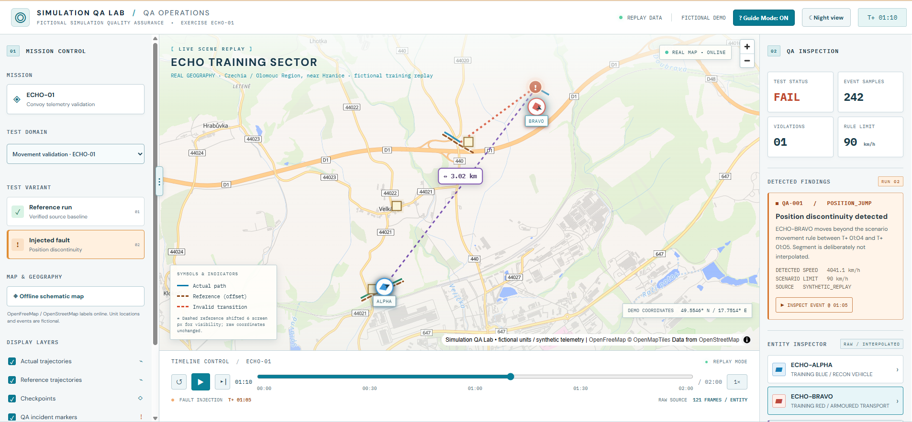

# Simulation QA Lab

**What it is:** An independent, browser-based QA lab for finding reproducible defects in fictional training-simulation telemetry and event logs.

**Why I built it:** To demonstrate how I turn raw data and explicit QA rules into clear findings, developer-ready evidence, and regression checks.

**Try it in about two minutes:** [Launch the live demo](https://tataboj.github.io/simulation-qa-lab/), select **Movement validation**, compare **Reference run** (PASS / 0 findings) with **Injected fault** (FAIL / 1 expected finding), and inspect or export the issue evidence.



*Actual screenshot of the public demo using synthetic training data; not a real simulator or live telemetry feed.*

**Version:** [v1.0.0](https://github.com/Tataboj/simulation-qa-lab/releases/tag/v1.0.0) (officially released on 2026-10-27). Maintained under [Tataboj](https://github.com/Tataboj).

**Live demo:** [Open Simulation QA Lab](https://tataboj.github.io/simulation-qa-lab/) (public GitHub Pages deployment).

## Try it

**Windows:** extract the project and double-click `START_WINDOWS.cmd`. The launcher uses `node` and `npm` from your Windows `PATH`, installs the locked dependencies, and prints a localhost address. Keep the terminal open while using the app. If `node` or `npm` is not recognized, configure the Node.js/npm command path first. The launcher was successfully tested in Windows CMD and Chrome on 2026-10-27 (RG-02).

**Terminal (Node.js 22.12+ with npm, or another Node.js version supported by Vite 7.3.7):** from the project directory:

```sh
npm ci
npm run dev
```

The interface runs in a modern browser. Python 3.12+ is needed only for the separate QA test suite.

## QA walkthrough

1. Select a **Test Domain** and open the **Reference run**. The expected result is **PASS**, with no findings.
2. Switch to **Injected fault**. The expected result is **FAIL**, with one actionable finding.
3. Inspect the original samples or event log alongside the replay and export the issue evidence.

| Domain | Injected fault | Authoritative evidence |
|---|---|---|
| Movement (`ECHO-01`) | `POSITION_JUMP` at T+01:05 | Original position/timestamp samples; fictional 90 km/h rule |
| Checkpoint (`ECHO-CP01`) | `CHECKPOINT_EVENT_MISSING` at T+00:58 | Checkpoint entry versus recorded `CHECKPOINT_ENTER` event |
| Event ordering (`ECHO-EV01`) | `EVENT_ORDER_VIOLATION` at T+00:35 | Completion at 35 s, start at 45 s in the original event log |

The animation is an explanation, **not the QA oracle**. Validation is based on raw synthetic records. An injected-fixture **FAIL** is the correct expected test outcome.

## Issue evidence

An issue package contains seven files: a summary, a detailed description, original evidence in JSON, an XLSX workbook, map evidence PNG, full-interface context PNG, and filing instructions. Export images provide context; they are not substitutes for the original telemetry or event log. Reports are prepared for manual filing, not sent to Jira or another service.

## Test and build

From the repository root:

```sh
python -m unittest discover -s tests -p 'test*.py' -v
node --test tests/*.test.js
python scripts/VP08_VERIFY_SCENARIOS.py
npm ci
npm audit
npm run build
```

As of 2026-10-27, acceptance evidence includes **16 Python tests, 117 JavaScript tests, and all six deterministic scenario fixtures**. Targeted Chrome/Windows checks (RG-03) verified clean/fault pairs for Movement, Checkpoint and Event Ordering, including seven-file fault evidence ZIPs and matching original JSON/XLSX telemetry (242 samples per scenario). This is targeted local acceptance, **not** exhaustive cross-browser coverage. The official release commit [`2a61aa7`](https://github.com/Tataboj/simulation-qa-lab/commit/2a61aa71362f0f2d051addc79aa4681914caf5d2) passed [CI #9](https://github.com/Tataboj/simulation-qa-lab/actions/runs/40468249528) and [CI #10](https://github.com/Tataboj/simulation-qa-lab/actions/runs/40472397526). Owner-approved [Pages deployment #5](https://github.com/Tataboj/simulation-qa-lab/actions/runs/40468602865) succeeded for the same commit; the hosted v1.0.0 footer was visually checked in Chrome on Windows. The production artifact retained **28/28 runtime dependency license/notice files**. These checks do not certify every browser or operating environment.

The included lockfile has SHA-256 `5F7E165CA8B435AD4701164B23DAAC04003B23D51D10C7A9A17075088D2BFCFC`.

**GitHub Pages:** the public demo is available at [tataboj.github.io/simulation-qa-lab](https://tataboj.github.io/simulation-qa-lab/). Locally, `npm run build:pages` builds the `/simulation-qa-lab/` base path. The Pages workflow remains **manual-only**; any new deployment requires owner approval.

## Scope and dependencies

All units, routes, events and faults are fictional. The online map uses real geographic labels from OpenFreeMap/OpenStreetMap; it is not a live feed. The alternate schematic background is local artwork. Initial dependency installation requires network access, and online maps / Google Fonts make third-party requests.

This is an independent, privately developed software-testing demo. It does not connect to a live system or represent any organization. See [architecture](docs/QA_ARCHITECTURE.md), [QA scope](docs/QA_SCOPE.md), [issue handoff](docs/ISSUE_TRACKER_HANDOFF.md), and [third-party provenance](docs/THIRD_PARTY_PROVENANCE.md).

**License:** [MIT](LICENSE) for original project code and assets, subject to the rights held by the copyright holder. See [third-party notices](THIRD_PARTY_NOTICES.md) and the [public runtime license index](https://tataboj.github.io/simulation-qa-lab/licenses/index.html) for external software, maps and fonts. Upstream licenses remain in force; they are not replaced by this project's MIT license.

The public repository, GitHub Pages demo, and official [v1.0.0 release](https://github.com/Tataboj/simulation-qa-lab/releases/tag/v1.0.0) are live. The released tag identifies commit `2a61aa71362f0f2d051addc79aa4681914caf5d2`; later documentation updates to `main` do **not** change that tag. Future Pages deployments remain manual-only and require separate owner approval.
